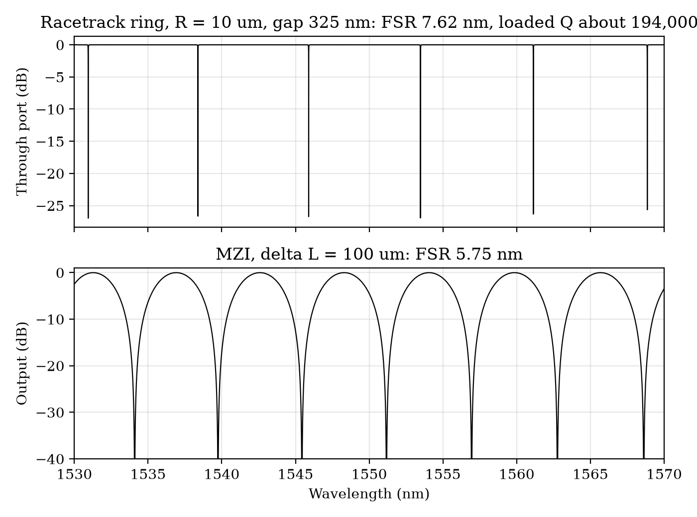
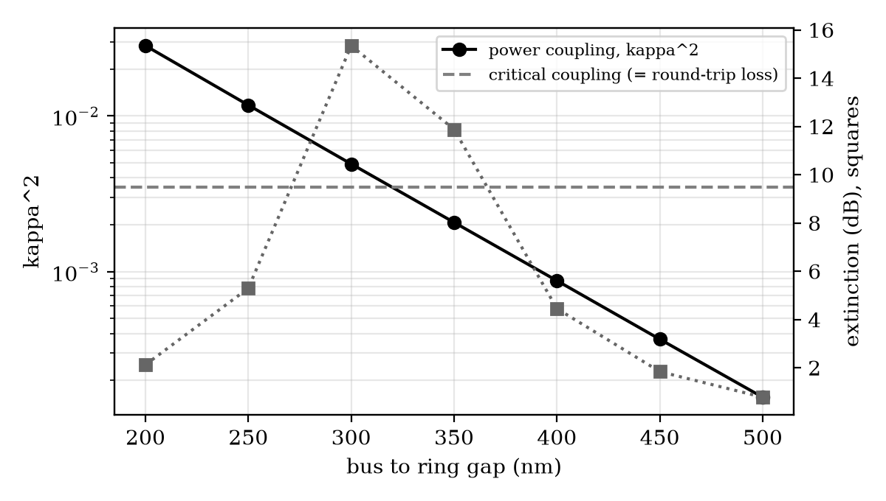
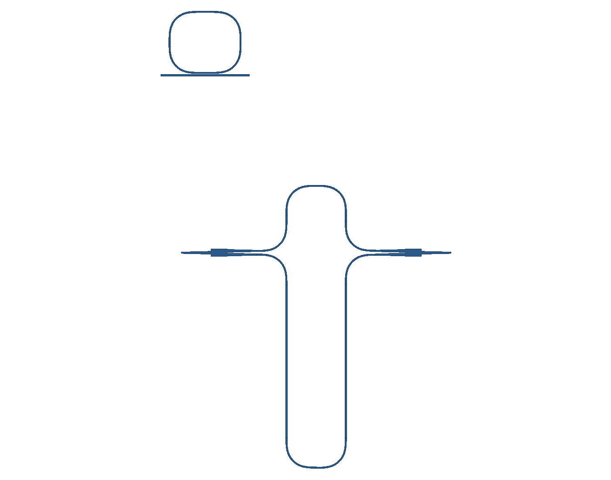

# Silicon photonics: ring resonator and MZI, from mode solve to DRC-clean layout

Team Rem | Rakshith Suresh (USC)

A small, end-to-end silicon photonics design study using only open tools. I solve the waveguide modes, design a racetrack ring resonator for critical coupling, simulate the ring and a Mach-Zehnder interferometer (MZI), lay both out, and check the layout with a KLayout DRC deck.

| Step | Tool | Output |
|---|---|---|
| Waveguide modes, material dispersion | femwell (finite-element mode solver) | n_eff, n_g, coupled supermodes |
| Coupling gap design | femwell supermodes + coupled-mode theory | gap for critical coupling |
| Ring and MZI spectra | transfer-matrix circuit model in NumPy | FSR, Q, extinction |
| Layout | gdsfactory (generic PDK, strip waveguide on layer 1/0) | GDS |
| Design rule check | KLayout Python (`width_check`, `space_check`) | violation counts |

## Results

**Waveguide** (500 x 220 nm silicon strip in oxide, TE0, 1550 nm, Sellmeier dispersion for Si and SiO2):

| Quantity | This work | Typical published value |
|---|---|---|
| Effective index n_eff | 2.444 | about 2.44 |
| Group index n_g | 4.18 | about 4.2 |

The match with published values for this standard waveguide (Chrostowski and Hochberg, *Silicon Photonics Design*) is the independent check on the mode solver setup.

**Ring resonator** (racetrack, R = 10 um Euler bends, 4 um coupling straights, path length 75.75 um taken from the GDS):

| Quantity | Value |
|---|---|
| Bus to ring gap | 325 nm (chosen for near-critical coupling) |
| Power coupling kappa^2 | 0.0032 (critical: 0.0035) |
| Resonance near 1550 nm | 1553.48 nm |
| FSR, simulated / theory | 7.618 nm / 7.618 nm |
| FWHM | 8 pm |
| Loaded Q | about 194,000 |
| Extinction | 26.9 dB |

**MZI** (path difference 100 um, ideal 50/50 splitters): FSR 5.754 nm, simulated and from theory.

**DRC** (WG.W.1 min width 0.40 um, WG.S.1 min space 0.20 um): 0 violations on the ring, the MZI and the combined top cell. A copy of the ring with a 150 nm gap is flagged with 17 space violations, which shows the deck catches real errors.



## Design notes

**Critical coupling.** My first ring used a 200 nm gap. It coupled 2.8% of the power per round trip, far more than the ring loses (about 0.35%), so it was strongly over-coupled and the resonance dip was only 2 dB deep. I swept the gap from 200 to 500 nm, solved the even and odd supermodes of the coupled waveguides at each gap, and found the gap where coupling equals round-trip loss. At 325 nm the dip is 26.9 dB deep.



**Layout and simulation must agree.** My first model assumed circular bends (ring length 70.83 um). gdsfactory draws Euler bends, which are longer, and adds two 0.6 um straights, so the real ring is 75.75 um. That 7% difference would have moved the predicted FSR by 7%. The simulation now reads the ring length from the same gdsfactory components that produce the GDS.

**Q sanity check.** At 2 dB/cm loss the intrinsic Q is 2 pi n_g / (alpha lambda), about 370,000. At critical coupling the loaded Q should be about half of that, close to the simulated 194,000.



## Limits (stated honestly)

- No fabrication or measurement. These are simulated results.
- No full 3D FDTD. Spectra come from a circuit model built on solved modes, which is the standard first-pass design method. FDTD would refine the coupler and bend behavior.
- The coupling model counts only the straight coupling section. The curved parts of the coupler add some coupling, so a real device would reach critical coupling at a somewhat larger gap.
- Propagation loss (2 dB/cm) is assumed, and bend loss is neglected (the Euler bends' minimum radius is 7 um).
- The layout uses gdsfactory's generic PDK, and the DRC deck is a two-rule example, not a foundry deck.
- The FSR agreement between simulation and theory checks that the circuit model and group index are implemented correctly. It is not an independent physical validation; the n_eff and n_g comparison above is.

## Run it

```bash
pip install -r requirements.txt     # gmsh needs libglu1-mesa on Ubuntu: sudo apt install libglu1-mesa
bash run_all.sh
```

Tested with gdsfactory 9.51.0, femwell 0.1.12, scikit-fem 12.0.2 and KLayout 0.30.14 (Python package).

| File | Purpose |
|---|---|
| `modes.py` | Waveguide and coupled-waveguide mode solves |
| `geometry.py` | Ring path length from the gdsfactory components |
| `gap_sweep.py` | Coupling gap sweep for critical coupling |
| `circuits.py` | Ring and MZI spectra, FSR, Q, extinction |
| `layout.py` | GDS generation |
| `drc.py` | KLayout DRC deck |
| `render.py` | Layout images from the GDS |

## Author

**Rakshith Suresh**
MS Electrical Engineering, Viterbi School of Engineering, University of Southern California

[GitHub](https://github.com/RakshithSuresh2001) | [LinkedIn](https://www.linkedin.com/in/rakshith-suresh-890329258) | [Website](https://rakshithsuresh2001.github.io)
